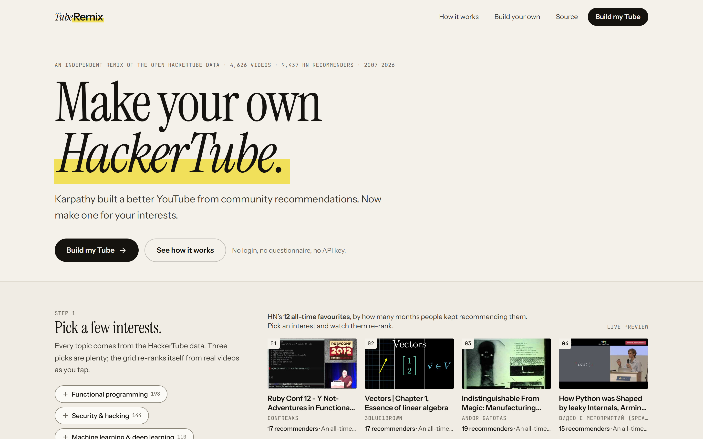
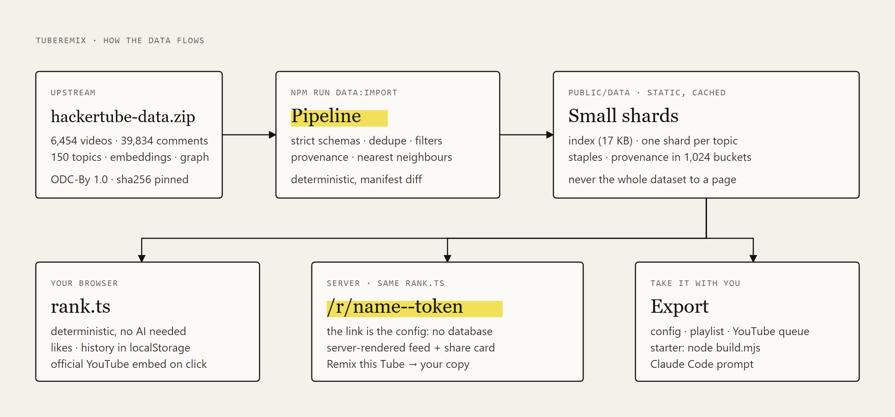

# TubeRemix

**Make your own HackerTube.** Karpathy built a better YouTube from community recommendations.
Now make one for your interests.



TubeRemix turns the open [HackerTube](https://hackertube.org) dataset (the YouTube videos that
Hacker News commenters kept recommending to each other) into a personal feed in a few clicks. No
login, no questionnaire, no API key, no command line. Pick a few interests, get a ranked feed of
real videos, open any video to see the HN comments behind it, then share your Tube as a link that
anyone can open and remix, or export a version you can run yourself.

TubeRemix is an independent community project. It is not affiliated with or endorsed by Andrej
Karpathy, HackerTube, YouTube, Google, Hacker News or Y Combinator.

## Why

On 1 November 2026 Andrej Karpathy [posted](https://x.com/karpathy/status/2116957135661945283)
that he had Claude filter 43M comments from 20 years of HN down to 6,454 videos that keep being
recommended, and put them in a YouTube-style UI at hackertube.org. He
[published the data](https://karpathy.bearblog.dev/hacker-tube/) so others could build their own
version. HackerTube is one person's front page for that data; TubeRemix lets anyone make theirs,
without writing code, and gives developers a working starting point when they want to.

## What it does

- **Builder with a live preview.** Tap interests on the landing page; the grid re-ranks real
  videos as you go. "Make my Tube" saves it in your browser.
- **Your Tube.** Home (top picks, a row per interest, saved videos, "off your map"), For You
  (one long ranked list), Explore (all videos by area, with format and era filters), Topics (the
  whole taxonomy), Watch Later, Liked, History, Customize. Keyboard shortcuts (`?`).
- **Receipts.** Every video shows who on HN recommended it and why: verbatim comments, stance
  labels, links to the original threads, "HN people also recommend" and similar videos.
- **Share and remix.** `/r/<name>--<token>` links render the same feed for anyone, server-side,
  with a generated share card. The link *is* the config, so nothing is stored. "Remix this Tube"
  copies it into your browser to change.
- **Export.** Config JSON, playlist (Markdown, CSV, JSON), a YouTube queue of the first 50, a
  starter project ZIP with your config inside, and a Claude Code prompt that builds your own site.
- **Optional AI.** Describe what you want in words. Keyword matching works with no AI; you can
  connect your own OpenAI, Anthropic or OpenRouter key, or your ChatGPT plan when running locally.

## Screenshots

| Desktop | Mobile |
|---|---|
|  |  |

## Run it

```bash
git clone https://github.com/VedSoni-dev/remixtube.git tuberemix
cd tuberemix
npm ci
npm run build        # downloads + validates the data, packs the starter, builds Next.js
npm start            # http://127.0.0.1:3000
```

Development: `npm run data:import && npm run starter:build && npm run dev`.
Tests: `npm test` (unit) and `npm run test:e2e` (Playwright, after a build).
More in [docs/SELF_HOST.md](docs/SELF_HOST.md).

## Data provenance

| | |
|---|---|
| Source | `https://hackertube.org/download/hackertube-data.zip`, exported 2026-10-31 |
| Pinned | 17,842,799 bytes, sha256 `c61bd220d1f3899152f63e6b159eece612f4da49727cc9e970bebba70279892e` ([data/source.lock.json](data/source.lock.json)) |
| Upstream | 6,454 videos · 39,834 labeled HN comments (16,184 recommendations) · 150 topics in 16 areas · co-recommendation graph · bge-small embeddings |
| TubeRemix keeps | 4,626 videos that at least one commenter recommended, where recommendations outnumber jokes and criticism, minus 14 duplicate uploads |
| Provenance shown | up to 8 comments per video (recommendations first), verbatim, with author, month, thread title and link |
| License | [ODC-By 1.0](https://opendatacommons.org/licenses/by/1-0/), credit HackerTube and [open-index/hacker-news](https://huggingface.co/datasets/open-index/hacker-news) |

`npm run data:import` downloads the zip once (cached in `.cache/`), refuses a different sha256
unless you pass `--update-lock`, validates every record against strict schemas
([src/pipeline/schema.ts](src/pipeline/schema.ts)), and writes small static files to
`public/data/`. It is deterministic (a test checks byte-identical output) and writes a manifest
of per-video hashes so a new export produces an added/removed/changed report.

Not included upstream, and so not here: durations, view counts and other YouTube metadata (the
YouTube API terms forbid redistributing them). Thumbnails come straight from `i.ytimg.com`;
videos play only through YouTube's official embed on `youtube-nocookie.com`. Nothing is scraped.

## Architecture



```
src/pipeline/   import: unzip, npy, strict schemas, source adapters, normalise + build static files
src/core/       shared, framework-free: ranking, share tokens, prefs, exporters, describe, zip writer
src/app/        Next.js routes: / , /tube/*, /r/[segment] (+ OG image), /build-your-own, /api/*
src/components/ UI: builder, cards, player + provenance, share/export, customize, AI panel
starter/        the downloadable starter (zero-dependency Node); lib/ is bundled from src/core + src/pipeline
```

- The browser downloads only what it needs: the topic index (~17 KB gz), one shard per chosen
  topic (~20 KB gz each), the staples (~32 KB gz), and a provenance bucket (~9 KB gz) when you
  open a video. Never the whole dataset.
- Shared Tubes are rendered on the server with the same ranking code, so a link works in a fresh
  browser, for crawlers, and in the share card.
- Source adapters ([src/pipeline/sources.ts](src/pipeline/sources.ts)) define how a new community
  source would plug in. Only HackerTube is implemented.

## Personalization: how ranking works

Deterministic, explainable, no model calls ([src/core/rank.ts](src/core/rank.ts)). Same inputs,
same feed. For each eligible video:

```
score = 0.50 × interest           # topic match: 1st topic ×1, 2nd ×0.6, 3rd ×0.4; weights curious 0.6 / into it 0.85 / obsessed 1; capped at 1
      + 0.30 × quality            # log(1 + HackerTube score) / log(1 + max)  (months recommended, strong recs count extra)
      + 0.18 × crowd              # log(1 + distinct recommenders) / log(1 + max)
      + 0.06 × rec quality        # (recs + 0.5 × strong − jokes − criticism) / mentions
      + 0.12 if no topic match but same area as a pick ("next door")
      ± format (+0.12 more / −0.22 less) ± depth (±0.06) − 0.03 dated − 0.10 news (when news is on)
      + 0.06 per liked video sharing a topic (max 3) − 0.08 per "not for me" topic (max 3)
      − 0.05 per earlier impression without a click (max 6, counted once a day)
      + serendipity jitter: seeded, ±0 / 0.06 / 0.12 / 0.20
```

Excluded: "not for me", watched (except on topic pages), unavailable, and news unless enabled.
Then slots are filled greedily with a variety penalty (−0.07 per same primary topic in the last 6
picks, −0.15 per same channel in the last 10). With serendipity on, every 9th / 6th / 4th slot is
the best-scored video from outside your topics. The feed ends when your topics run out.

With no interests it ranks HackerTube's all-time favourites. Every weight is the `W` object in
`rank.ts`; the starter exposes it as `WEIGHTS`.

## Make your own

- **No code:** build a Tube, Share & export → Starter project. Unzip, `node build.mjs`,
  `node serve.mjs`. See [starter/README.md](starter/README.md).
- **With an agent:** Share & export → Copy a Claude Code prompt, paste into Claude Code.
- **Everything:** fork this repo. The guide at `/build-your-own` walks through the data, the
  filters, ranking, running, customizing, deploying and sharing.

## Deploy

Any Node host or Vercel (`npm run build`, then `npm run start:public` or Vercel's default). Set
`NEXT_PUBLIC_SITE_URL`. No database, no secrets. Details in [docs/SELF_HOST.md](docs/SELF_HOST.md).

## Privacy and analytics

Preferences, likes and history stay in your browser. A handful of product events (landing view,
builder started, interests selected, feed generated, video opened, share, shared Tube opened,
remix, export) are counted with a random per-tab id and no content ids; Global Privacy Control
and Do Not Track switch them off. `npm run analytics:report` computes visitor→feed, median
time-to-feed, share, remix and export rates. See `/privacy`.

## Bring your own AI

Only officially supported routes: your own API key (OpenAI, Anthropic, OpenRouter), Sign in with
OpenRouter (OAuth PKCE), and Sign in with ChatGPT plan usage on local installs (OpenAI allows it
for open-source apps on the user's own computer). Claude subscriptions can't be used by
third-party apps under Anthropic's terms, so TubeRemix offers an API key or the Claude Code
prompt instead. Details: [docs/AI_PROVIDERS.md](docs/AI_PROVIDERS.md).

## Licensing and attribution

- Code: MIT ([LICENSE](LICENSE)).
- Data: HackerTube by Andrej Karpathy, ODC-By 1.0, derived from the open-index/hacker-news
  archive. Hacker News data is provided by Y Combinator; comments remain the work of their
  authors. Video titles, channel names and thumbnails belong to their creators.
- Fonts: Instrument Serif, Instrument Sans, JetBrains Mono (SIL Open Font License).
- HackerTube's website code is not open source; only its data is published. TubeRemix doesn't
  use or copy it.

## Limitations

- One source (HackerTube). Other sources need a new adapter; none is wired.
- No video-length preference: durations aren't in the data.
- Removed videos are detected only when they fail to play or lose their thumbnail.
- Stances, summaries and topics were written by an LLM upstream; a few percent are off.
- Sign in with ChatGPT is implemented to OpenAI's published spec but hasn't been verified end to
  end with a real account.
